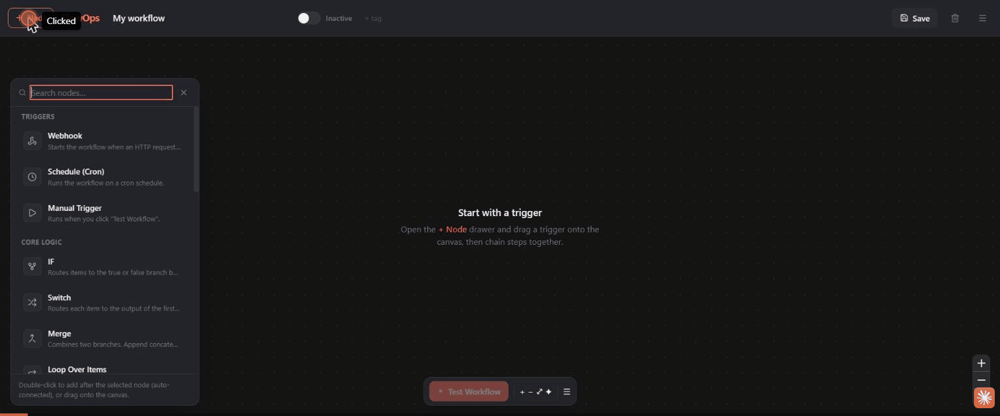

# FlowOps

A self-hosted, n8n-style workflow automation tool: a node-based editor, an execution
engine with loops, retries and resumable waits, live webhooks and schedules, AI nodes
(Claude, OpenAI-compatible, Gemini), encrypted credentials, and full execution history.



The recording shows the editor running the **Morning Email Brief** example end to end (MP4
versions are in [`docs/`](docs/)). The email it drafts is rendered in
[`docs/morning-brief-email.html`](docs/morning-brief-email.html).

```
┌─────────────────────────────┐        ┌──────────────────────────────────┐
│  web/  React + React Flow   │  HTTP  │  server/  Express + engine        │
│  canvas · inspector · logs  │ ─────► │  memory or Postgres · inline or   │
└─────────────────────────────┘        │  Redis queue                      │
                                       └──────────────────────────────────┘
```

## Quick start

```bash
npm install
npm run dev:server     # API on http://127.0.0.1:5175
npm run dev:web        # editor on http://localhost:5173 (proxies the API and webhooks)
```

With no configuration the server keeps its data in `server/data/memory-store.json`, runs
jobs in-process, and only listens on `127.0.0.1`.

### Run everything with Docker

```bash
API_TOKEN=$(openssl rand -hex 24) ENCRYPTION_KEY=$(openssl rand -hex 32) docker compose up -d
```

This starts FlowOps with PostgreSQL and Redis at http://localhost:5175. The editor asks
for the API token once and remembers it in your browser. Keep `ENCRYPTION_KEY` safe:
stored credentials can't be decrypted without it.

### Production build without Docker

```bash
npm run build          # server (tsc) + editor (vite)
npm start              # serves the API and the built editor from one process
```

## Configuration

| Env var          | Effect |
| ---------------- | ------ |
| `API_TOKEN`      | Every `/api` request must send `Authorization: Bearer <token>`. **Required** when `HOST` is not loopback. |
| `PUBLIC_ACCESS`  | `true` lets anyone use the editor and API with no token (`API_TOKEN` is ignored). The Code node is switched off in this mode. |
| `HOST`           | Interface to listen on (default `127.0.0.1`). The server refuses to start on any other address without `API_TOKEN` or `PUBLIC_ACCESS=true`. |
| `ENCRYPTION_KEY` | Key for AES-256-GCM credential encryption. **Required** when `NODE_ENV=production`. |
| `PORT`           | Port (default `5175`). |
| `PUBLIC_URL`     | Base URL used in Wait-node resume links (default `http://localhost:PORT`). |
| `CORS_ORIGIN`    | Comma-separated origins allowed to call the API from a browser. Empty = none (the editor uses a same-origin proxy). |
| `DATABASE_URL`   | PostgreSQL connection string; the schema in `server/db/schema.sql` is applied on boot. |
| `REDIS_URL`      | Use Redis + BullMQ for queued webhook runs (3 attempts, exponential backoff). |
| `DATA_FILE`      | Path of the JSON file used when there is no database. |

See [`.env.example`](.env.example).

> **Security note.** The Code node runs JavaScript in `node:vm`, which is an isolation
> boundary, not a security sandbox. Anyone who can call the API can run code on the
> server, which is why the API binds to localhost and requires a token otherwise. With
> `PUBLIC_ACCESS=true` the Code node is disabled, but visitors can still edit or delete
> any workflow and use any saved credential, so don't store paid API keys or a real SMTP
> account on a public instance.

## Features

### Engine (`server/src/engine/`)
- **Graph execution:** items (`[{ json, binary }]`) flow along connections. IF and Switch
  send items only to the matching output, and dead branches are marked *skipped*.
- **Loops:** *Loop Over Items* runs the nodes on its `loop` output once per batch (wire
  the last one back into the loop node), then emits every result on `done`.
- **Retries and error routing per node:** retry N times with a delay. On failure, stop the
  branch, continue with an `error` field, or send failed items to an extra `error` output.
- **Resumable waits:** a Wait of a few seconds runs inline. Longer waits, a specific
  date/time, or "until the resume URL is called" save the run and resume later, even
  after a restart. The resume URL is available as `{{ $execution.resumeUrl }}`.
- **Pinned data:** pin a node's output in the inspector and manual runs reuse it instead
  of calling the API again. Production runs ignore pins.
- **Expressions:** `{{ $json.body.email }}`, `{{ $('Webhook').item.json.body.id }}`
  (any earlier node by name), `$input.all()`, ternaries, comparisons, method calls,
  `$now.format('dddd, MMMM D')` and `$now.plus(1, 'day')`. Prototype access is blocked
  and only whitelisted globals are reachable.
- **Error workflows:** a failed run sends `{ error, workflowId, executionId }` to the
  workflow named in `settings.errorWorkflow`.

### Nodes
| Group | Nodes |
| --- | --- |
| **Triggers** | Webhook (respond immediately, with the last node, or via *Respond to Webhook*; optional HMAC signing credential), Schedule (cron + timezone), Manual |
| **Core logic** | IF, Switch, Merge, Loop Over Items, Wait, Code (JavaScript), No Operation |
| **Data** | Edit Fields (Set), Filter, Sort, Limit, Remove Duplicates, Split Out, Aggregate, Respond to Webhook |
| **AI** | AI Agent and LLM Chain with **Claude** (Anthropic SDK, default `claude-opus-5-5`), OpenAI-compatible, Gemini, or an offline `local` template provider |
| **Apps** | HTTP Request (per item, query/JSON/form bodies, header/bearer/basic auth, pagination), PostgreSQL, Redis (get/set/delete/incr), Slack, Send Email (SMTP, or `.eml` files in an outbox when no credential is attached), OpenAI |
| **Coming soon** | Vector Store, Memory, Tool Calling, Gmail (shown in the palette, not runnable yet) |

### Editor (`web/`)
- Drag-and-drop canvas with run status, item counts on wires, and tidy-up layout.
- Three-pane inspector: input data, parameters (fields appear only when relevant), and
  output per branch. *Test Step* runs a single node with real upstream data.
- Expression suggestions from the actual input fields and upstream node names. Type `{{`
  or click `{ }`.
- **Undo/redo** (`Ctrl+Z` / `Ctrl+Shift+Z`), **copy/paste/duplicate** nodes
  (`Ctrl+C` / `Ctrl+V` / `Ctrl+D`), save (`Ctrl+S`).
- **Version history:** every save is kept (newest 50) and any version can be restored.
- **Import/export** workflows as JSON. Exports contain credential *references*, never
  secrets.
- Execution log with replay, plus *Resume now* for waiting runs.

### API
- `/api/workflows` CRUD, activate/deactivate, `/run`, `/versions`, `/versions/:id/restore`
- `/api/nodes/test`, `/api/executions` (list, detail, replay, resume, delete), `/api/credentials`
- Webhooks (not behind the API token):
  - `/webhook/:workflowId/:path`: production
  - `/webhook-test/:workflowId/:path`: synchronous, returns the last node's output
  - `/webhook-waiting/:executionId`: resumes a waiting run

## Example: a morning email brief

[`tests/morning-brief-workflow.json`](tests/morning-brief-workflow.json) is the workflow
from the recording. Import it with the editor's **Import** button:

```
Schedule (0 8 * * *) → Build Brief Data (Code) → Draft Email (AI Agent) → Compose Message (Code) → Send Email
```

With `provider = local` and no SMTP credential it runs with no accounts at all. The draft
is a template, and the email lands as an `.eml` file in `server/data/outbox/`. Attach an
Anthropic, OpenAI or Gemini credential for a real draft, and an SMTP credential to send it.

## Development

```bash
npm test               # engine, node, expression and trigger tests (Vitest)
npm run typecheck      # server + editor
npm run build
```

CI runs the tests and the build on every push and pull request
([`.github/workflows/ci.yml`](.github/workflows/ci.yml)).

## Known limitations

- The Code node can't use `async` or `require` (synchronous `vm`, 5 s timeout).
- Webhook secrets typed into a node's old *HMAC secret* field still work, but new
  workflows should use a *Webhook Signing Secret* credential, which is stored encrypted.
- Gmail, Vector Store, Memory and Tool Calling are not implemented yet.

## License

[MIT](LICENSE)
